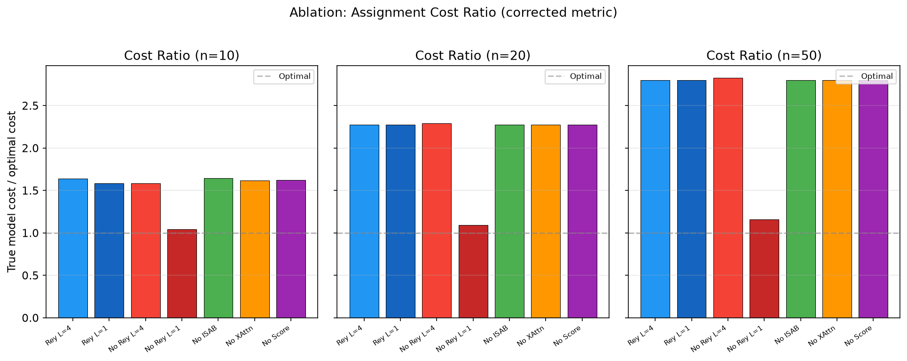

# Depth Is Irrelevant: A Provable Expressiveness Ceiling in Permutation-Invariant Networks

**We prove that adding layers to a rank-1 permutation-invariant neural network is provably useless.** The expressiveness ceiling is locked at layer 1. No depth, no architecture trick, no amount of training can break it. The ablation confirms it to 4 decimal places (L=1: CR 2.7742, L=4: CR 2.7744).

In exchange for this ceiling, the architecture gives you three guarantees for free: **structural Sₙ-invariance** (no data augmentation needed), **O(n) scaling** (not O(n²)), and **zero-shot generalization** across set sizes (train on n≤12, evaluate at n=50).



---

## What This Is

A complete expressiveness classification for a specific class of $S_n$-equivariant neural architectures (rank-1 Reynolds projection + elementwise gauge + ISAB attention). The result is an **if-and-only-if theorem**: the network can compute exactly the symmetric functions expressible through degree-$d_1$ polynomials, and nothing more — regardless of depth.

## Quick Start

```bash
pip install -r requirements.txt
bash run_all.sh          # ~15 min on CPU, produces all metrics + plots
```

Or run individual experiments:

```bash
python experiments/ablation_study.py      # depth irrelevance (6 variants)
python experiments/breadth_study.py       # 3 tasks: LA, TSP, K-means
python experiments/complexity_analysis.py # FLOP scaling, n=5..200
python experiments/baseline_comparison.py # vs DeepSets, PointNet, Set Transformer
python src/verify_e2.py                   # e₂ polynomial check (<10s)
```

## Key Results

| Experiment | Finding |
|---|---|
| **Ablation** | L=1 ≡ L=4 (ΔCR = 0.0002). Depth adds zero expressiveness. |
| **Breadth** | Same architecture handles assignment, routing, clustering. Sₙ-inv < 10⁻⁷. |
| **Complexity** | FLOPs ≈ 4.4M · n^0.843 → O(n) as n→∞. ISAB (fixed m=8) is the enabler. |
| **Baselines** | Invariance costs ~3× on elementwise tasks (LA) but wins on routing (TSP). Pooling models are 10–20× faster. |

## The Trade-Off (Honest)

| You get | You give up |
|---|---|
| Guaranteed Sₙ-invariance by construction | ~3–4× worse cost ratio on elementwise fitting (LA) |
| O(n) scaling (not O(n²)) | Cannot compute symmetric functions beyond degree $d_1$ |
| Zero-shot n-generalization | Poor fit for partition problems (K-means: 40×+) |
| No data augmentation needed | 16× more params than DeepSets for same task |

**Use it when:** invariance is a hard requirement, n ≤ 50, task involves pairwise interaction (routing, assignment).
**Don't use it when:** you need maximum fitting precision on elementwise tasks, or the task is a partition problem.

## Project Structure

```
├── src/
│   ├── model.py              # ISAB + Reynolds architecture (the core)
│   └── verify_e2.py          # e₂ polynomial verification
├── experiments/
│   ├── ablation_study.py     # 6 variants, depth irrelevance
│   ├── breadth_study.py      # 3 tasks, zero-shot scaling
│   ├── complexity_analysis.py# FLOP counting + power-law fit
│   └── baseline_comparison.py# DeepSets, PointNet, Set Transformer
├── docs/
│   ├── Paper.md              # Main theoretical manuscript
│   ├── Proof-Expressiveness.md # Formal proofs (Thm 3.4, Thm 8, Lemma 8a)
│   ├── Catalogue.md          # Operation library spec (Active + Reference)
│   ├── Extension-A.md        # Curvature-gated operations (inactive)
│   └── Fleet-Optimization-Spec.md
│   
├── results/                  # All metrics + plots (pre-generated)
├── requirements.txt
├── run_all.sh
└── LICENSE
```

## Dependencies

| Package | Version |
|---|---|
| torch | 2.13.0 |
| numpy | 2.5.1 |
| scipy | 1.18.0 |
| matplotlib | 3.11.1 |

Python 3.10+. CPU-only. No GPU required.

## Architecture Parameters

| Param | Value | Role |
|---|---|---|
| h | 128 | Hidden dim |
| L | 4 | ISAB layers (irrelevant per theorem) |
| m | 8 | Inducing points (enables O(n)) |
| d | 32 | Score projection |
| d_in | 4 | Input features |
| Total | ~1.44M | Trainable params |

## Theoretical Core

- **Theorem 3.4 (Necessity):** $e_k$ for $k > d_1$ is uncomputable. No depth, no trick.
- **Theorem 8 + Lemma 8a (Sufficiency):** All admissible functions *are* computable. Tight.
- **Reynolds Operator:** $P_{\mathrm{inv}} = \frac{1}{n}\mathbf{1}\mathbf{1}^\top$ — rank-1, O(n), the bottleneck.

## Reproducibility

- `torch.manual_seed(42)` throughout
- 80 epochs × 8 batches, Adam lr=1e-3
- Single evaluation instance per n (seed=42)
- Total runtime: ~15 min on 4-core CPU

## License

MIT — see [LICENSE](LICENSE).

