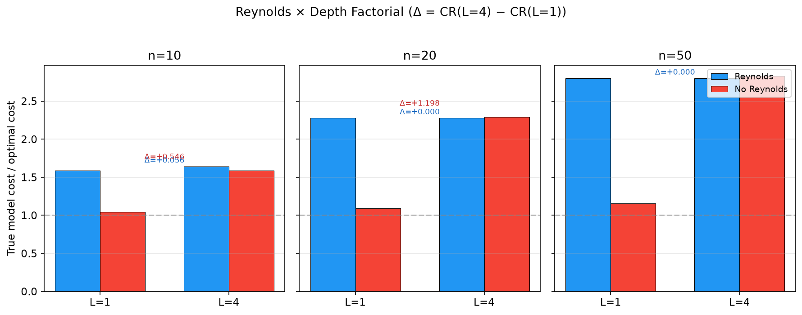

# Depth Is Irrelevant: A Provable Expressiveness Ceiling in Permutation-Invariant Networks

**We prove that adding layers to a rank-1 permutation-invariant neural network is expressively useless.** After the first Reynolds projection the state is a single invariant scalar; layers \(2,\ldots,L\) can only remap that scalar. Depth cannot enlarge the function class.

Empirically, a **Reynolds × depth factorial** ablation (corrected true-cost metric) shows the same pattern in the soft centroid-attention proxy used here: with Reynolds, L=1 ≈ L=4; without it, depth is free to matter.

In exchange for this ceiling, the architecture gives three guarantees: **structural Sₙ-invariance** (no data augmentation), **O(n) scaling** via ISAB (not O(n²)), and **zero-shot generalization** across set sizes (train on n≤15, evaluate at n=50).



---

## What This Is

A complete expressiveness classification for a specific class of \(S_n\)-equivariant neural architectures (rank-1 Reynolds projection + equivariant layers). The result is an **if-and-only-if theorem**: the network computes exactly the smooth functions of one degree-\(\le d_1\) invariant polynomial — regardless of depth.

The code implements a practical **fleet / set-attention proxy** (ISAB + mean-centroid cross-attention). That soft “Reynolds” step is not identical to the paper’s hard \(P_{\mathrm{inv}}\); treat the theorem and the fleet experiments as complementary, not interchangeable.

## Quick Start

```bash
pip install -r requirements.txt
bash run_all.sh          # ~15 min on CPU, produces all metrics + plots
```

Or run individual experiments:

```bash
python experiments/ablation_study.py      # Reynolds×depth factorial + components
python experiments/breadth_study.py       # 3 tasks: LA, TSP, K-means
python experiments/complexity_analysis.py # FLOP scaling, n=5..200
python experiments/baseline_comparison.py # vs DeepSets, PointNet, Set Transformer
python src/verify_e2.py                   # e₂ polynomial check (<10s)
```

## Key Results

| Experiment | Finding |
|---|---|
| **Ablation (factorial)** | With Reynolds: L=1 ≡ L=4 at n=50 (true CR 2.7980, Δ=0). Without Reynolds: L=1 CR 1.16 vs L=4 CR 2.83 — depth moves quality. |
| **Breadth** | Same stack on LA / TSP / K-means. Sₙ-inv ≤ ~2×10⁻⁷. K-means remains poor (~35–45×). |
| **Complexity** | FLOPs ≈ 4.4M · n^0.843 → O(n) as n→∞. ISAB (fixed m=8) is the enabler. |
| **Baselines** | LA n=50: Catalogue CR 2.80 vs DeepSets 1.10 (~2.5× worse). TSP n=10: Catalogue 1.65 beats DeepSets 1.86; Set Transformer leads at 1.50. Pooling models are ~10–15× faster. |

### Cost-ratio definition

**Cost ratio = true cost of the assignment induced by model scores / optimal true cost.**  
(Earlier drafts accidentally used the predicted-score sum in the numerator; that conflates score scale with assignment quality. Ablation and `src/model.py` now match breadth/baselines.)

## The Trade-Off (Honest)

| You get | You give up |
|---|---|
| Guaranteed / near-structural Sₙ-invariance | ~2.5× worse true cost ratio on LA vs DeepSets (n=50) |
| O(n) scaling (not O(n²)) | Cannot compute symmetric functions beyond degree \(d_1\) (hard \(P_{\mathrm{inv}}\) theorem) |
| Zero-shot n-generalization | Poor fit for partition problems (K-means: 35–45×) |
| No data augmentation needed | ~16× more params than DeepSets for the same task |

**Use it when:** invariance is a hard requirement, n ≤ 50, task involves pairwise interaction (routing, assignment).  
**Don't use it when:** you need maximum fitting precision on elementwise tasks, or the task is a partition problem.

See `docs/Paper.md` §7 for the hard-\(P_{\mathrm{inv}}\) theorem vs soft-centroid code distinction.

## Project Structure

```
├── src/
│   ├── architecture.py       # Shared ISAB / SetBlock / FleetPolicy (+ baselines)
│   ├── model.py              # Training + theorem verification harness
│   └── verify_e2.py          # e₂ polynomial verification
├── experiments/
│   ├── ablation_study.py     # Reynolds×depth factorial + component ablations
│   ├── breadth_study.py      # 3 tasks, zero-shot scaling
│   ├── complexity_analysis.py# FLOP counting + power-law fit
│   └── baseline_comparison.py# DeepSets, PointNet, Set Transformer
├── docs/
│   ├── Paper.md              # Main theoretical manuscript
│   ├── Proof-Expressiveness.md # Formal proofs (Thm 3.4, Thm 8, Lemma 8a)
│   ├── Catalogue.md          # Operation library spec (Active + Reference)
│   ├── Extension-A.md        # Curvature-gated operations (inactive)
│   └── Fleet-Optimization-Spec.md
├── results/                  # Metrics + plots
├── requirements.txt
├── run_all.sh
└── LICENSE
```

## Dependencies

| Package | Version |
|---|---|
| torch | ≥ 2.2 |
| numpy | ≥ 1.26 |
| scipy | ≥ 1.11 |
| matplotlib | ≥ 3.8 |

Python 3.10+. CPU-only is fine.

## Architecture Parameters

| Param | Value | Role |
|---|---|---|
| h | 128 | Hidden dim |
| L | 4 | ISAB layers (irrelevant under hard \(P_{\mathrm{inv}}\); factorial tests the soft proxy) |
| m | 8 | Inducing points (enables O(n)) |
| d_in | 4 | Input features |
| Total | ~1.44M | Trainable params (L=4 full) |

## Theoretical Core

- **Theorem 3.4 (Necessity):** \(e_k\) for \(k > d_1\) is uncomputable. No depth, no trick.
- **Theorem 8 + Lemma 8a (Sufficiency):** All admissible functions *are* computable. Tight.
- **Reynolds Operator:** \(P_{\mathrm{inv}} = \frac{1}{n}\mathbf{1}\mathbf{1}^\top\) — rank-1, O(n), the bottleneck.

## Reproducibility

- `torch.manual_seed(42)` / `np.random.seed(42)` at experiment entry (per-task reseed in breadth/baselines)
- 80 epochs × 8–10 batches, Adam lr=1e-3
- Cost ratios averaged over 20 eval seeds per n (ablation, breadth, baselines)
- Baselines: fresh weights per (model, task) — no LA→TSP fine-tune carry-over
- Total runtime: ~15 min on a 4-core CPU

## License

MIT — see [LICENSE](LICENSE).

## Models - Contributors 
- Cursor (auto)
- inkling-2-mini                             
- qwen3.8:27b
                                                     
## Claim
- To our knowledge, this depth-irrelevance / degree classification for hard inter-layer Reynolds projection has not been stated in this form, with the usual caveat that no search is exhaustive.


